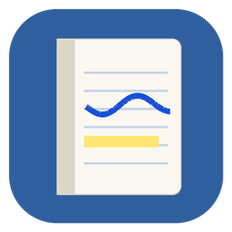
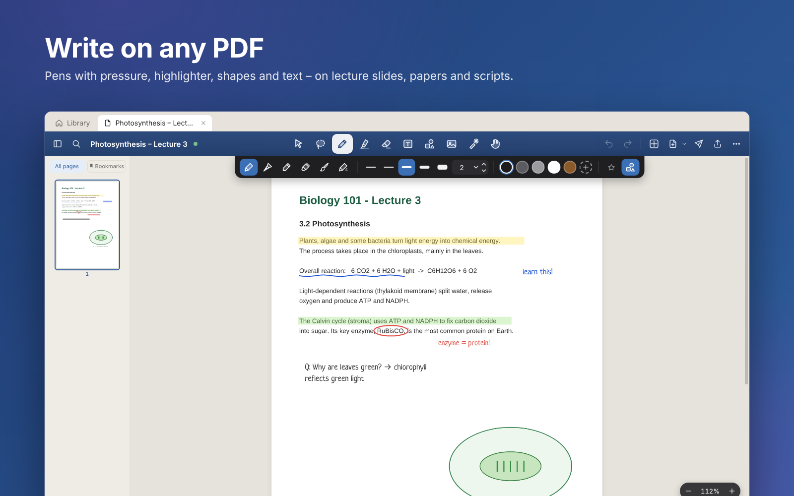
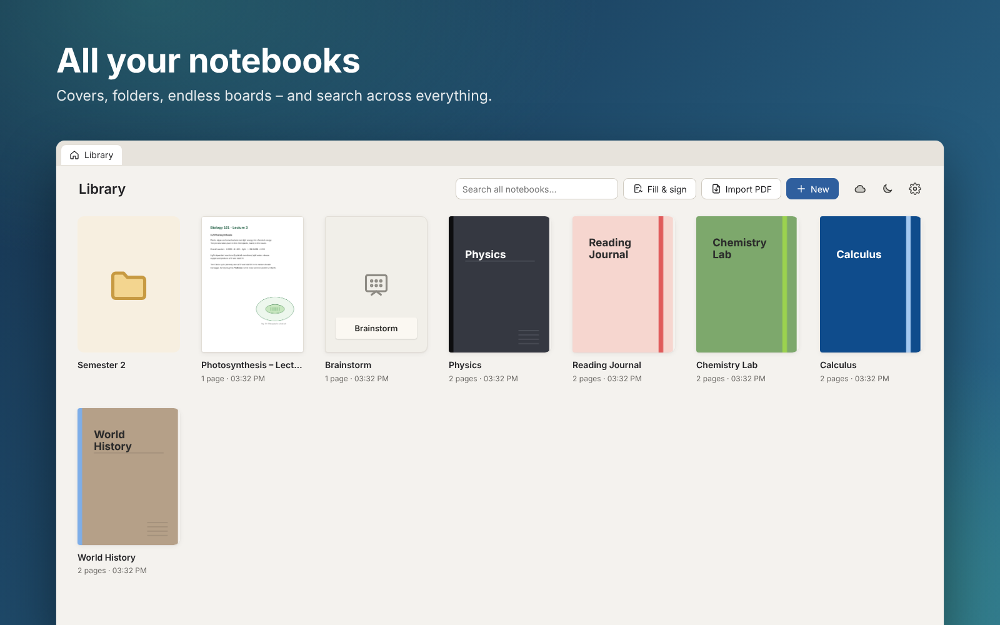
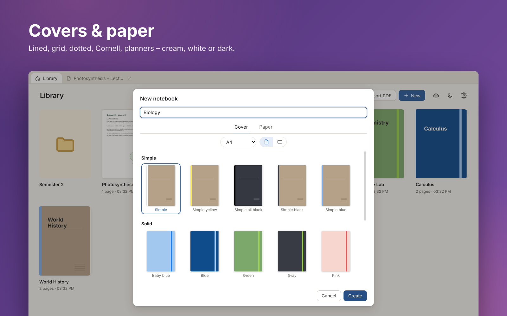
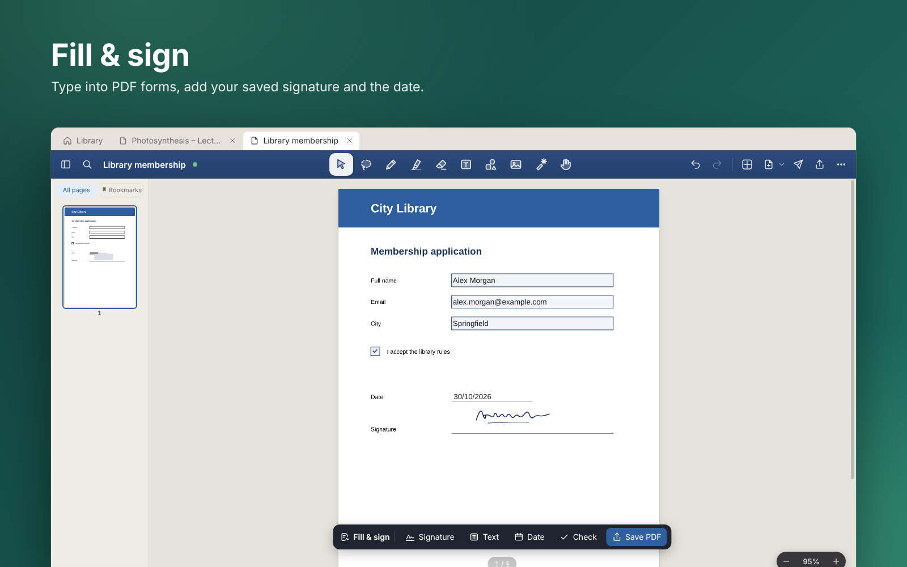
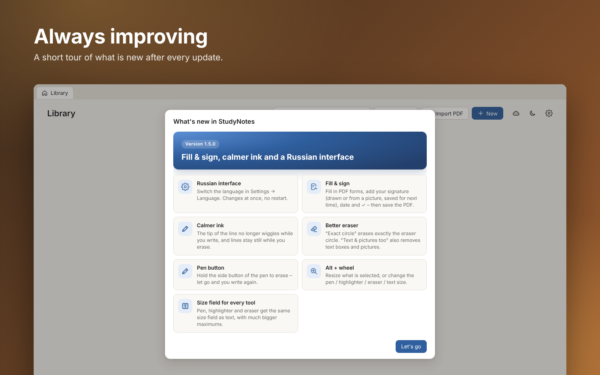

<p align="center">
  
</p>

<h1 align="center">StudyNotes</h1>

<p align="center">
  <b>Handwritten study notes and PDF annotation for Windows – in the style of GoodNotes.</b><br>
  Write on lecture scripts with a pen, keep everything in notebooks, sync with your own Google Drive.
</p>

<p align="center">
  <a href="https://github.com/vlmelnik/studynotes/releases/latest"></a>
</p>

<p align="center">
  
  
  
</p>

<p align="center">
  
</p>

## Why StudyNotes

- **Made for lecture scripts.** PDFs with hundreds or thousands of pages open in about a second and scroll smoothly.
- **Writes like paper.** Pressure-sensitive pens (ballpoint, fountain, pencil, marker, brush, neon), highlighter, shapes that snap clean when you hold the pen still.
- **Your files stay yours.** Notes are plain folders on your PC. Sync goes to *your* Google Drive, and StudyNotes only sees the files it created.
- **Nothing gets lost.** Saved within ~2 seconds, hourly local backups, repair after a crash or power cut.

## Features

<p align="center"></p>

<p align="center"></p>

<p align="center"></p>

<p align="center"></p>

**Also inside**

- ✏️ **Tools:** pen, highlighter, eraser (partial, exact circle, whole stroke, also text & pictures), lasso, shapes with fill, text boxes with fonts and styles, tables, pictures with AI background removal, laser pointer.
- 🖊️ **Pen button:** hold the side button of your pen to erase, let go to write again. Works with Wacom, XP-Pen, Huion (Windows Ink).
- 🔎 **Search:** the PDF text and your typed notes, in one notebook or all of them.
- 📄 **Open any PDF with StudyNotes:** right-click → *Open with* → StudyNotes. Your notes are written into that PDF, so every PDF reader shows them – and they stay editable in StudyNotes.
- 📤 **Export & share:** whole notebook, one page or a page range as PDF; send by e-mail or Telegram.
- ☁️ **Google Drive sync:** one-click sign-in, PDFs + backups in a *StudyNotes* folder in your Drive.
- 🌍 **English or Russian** interface – switch any time in Settings.
- ↩️ **Undo / redo** for everything, tabs for several notebooks, dark mode.

See the [user guide](docs/USER-GUIDE.md) for details and keyboard shortcuts, and the [changelog](CHANGELOG.md) for what changed in each version.

## Install

1. Download **`StudyNotes-Setup-x.y.z.exe`** from the [latest release](https://github.com/vlmelnik/studynotes/releases/latest) and run it.
   Updating: install over the old version – your notes stay where they are.
2. Windows SmartScreen may say *"Windows protected your PC"* because the app is not code-signed: click **More info → Run anyway**.
3. Prefer no installer? Download the `.zip`, unzip it anywhere and start `StudyNotes.exe`.

**Graphics tablet:** pen pressure needs *Windows Ink* in the tablet driver (Wacom: Wacom Tablet Properties → Mapping → *Use Windows Ink*).

## Build from source

Requires Node.js 20 or newer.

```bash
npm install
npm start            # build the renderer and run the app
npm test             # unit tests
npm run dist:win     # Windows installer + portable zip into release/
```

Google Drive sync uses a Google OAuth client. Its values are not part of the source: put them into `src/main/google-client.local.js`

```js
module.exports = { clientId: '…apps.googleusercontent.com', clientSecret: '…' };
```

or set `STUDYNOTES_GOOGLE_CLIENT_ID` / `STUDYNOTES_GOOGLE_CLIENT_SECRET`. Without them, sync still works with your own client (Settings → Google Drive → *Advanced*).

End-to-end tests drive the real app with Playwright (on Linux prefix with `xvfb-run -a`):

```bash
node test/e2e/run.js       # core tools on a generated 600-page PDF
node test/e2e/v15.js       # newest features
```

<details>
<summary>Code overview</summary>

- `src/main/` – Electron main process: storage with atomic writes (`library.js`), PDF export (`export.js`), Drive sync (`cloud.js`, `sync.js`), PDFs opened in place (`external.js`), PDF forms and signatures (`forms.js`), local backups (`localbackup.js`).
- `src/renderer/` – UI: page viewer (`viewer.js`), pen input and tools (`tools.js`), editor with undo and autosave (`editor.js`), library (`library-view.js`), interface language (`i18n.js`), Fill & sign (`fill-sign.js`).
- `src/shared/` – used by both screen and export: ink outlines (`ink.js`), eraser and shape geometry (`geometry.js`), paper (`paper.js`), Russian texts (`i18n-ru.js`).
- `graphify-out/` – a code map (`GRAPH_REPORT.md`, `graph.html`), refreshed with `npm run graph`.

</details>

## Licence

StudyNotes is MIT-licensed © 2026 vlmelnik. It bundles open-source software and fonts under their own licences – see [THIRD-PARTY-NOTICES](assets/THIRD-PARTY-NOTICES.txt) (also in the app: Settings → About StudyNotes → Licences).

StudyNotes is an independent project and not affiliated with GoodNotes.
